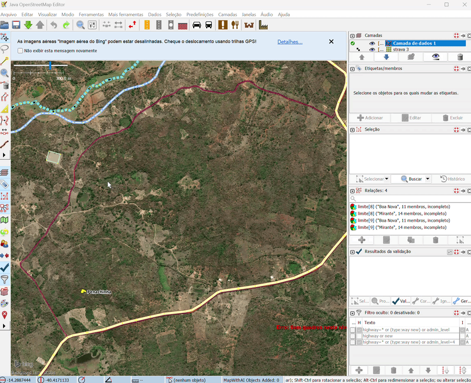

# StravaTracer (JOSM plugin)

Two tools to map from the Strava heatmap in JOSM:

- **Strava trace**: click on a trace of the heatmap and the plugin creates the missing way, already connected to the existing ones.
- **Slide along Strava heatmap** (Shift+S): slide a roughly drawn or misaligned way onto the trail of the heatmap.



🎬 [Full demo video on YouTube](https://www.youtube.com/watch?v=B0Jxzoc-fMQ)

The tracer is based on the idea and the algorithm of [osm-strava](https://github.com/archie83/osm-strava) (GPL-3.0). Slide is a port of the Slide operation of [strava-heatmap-extension](https://github.com/julcnx/strava-heatmap-extension) (MIT), itself based on [paulmach/slide](https://github.com/paulmach/slide). See [NOTICE](NOTICE).

## Installation

In JOSM, open *Preferences → Plugins*, search for **stravatracer** and enable it.
The plugin can also be downloaded from the [releases](https://github.com/erickdeoliveiraleal/josm-strava-tracer/releases).

## Strava trace

1. Select the **Strava trace** mode in the left toolbar.
2. Click on a hot trace of the heatmap.
3. The plugin:
   - downloads the tiles around the click **through the Strava imagery layer opened in JOSM**, reusing its URL, cookies and HTTP headers;
   - reads the heat level of every pixel: Strava's tiles store it whatever the colours shown (hot, blue, purple, gray…), as the palette index of the indexed tiles or the value of the grey level tiles;
   - masks a band around the ways already in the data layer (`highway`, `railway`, `leisure=track`, `route=ferry`, `aeroway=runway|taxiway`);
   - starting from the hottest pixel near the click, takes the connected trace with a threshold **relative to the popularity of the clicked trace** (rarely and heavily used traces work with the same settings), jumping over small gaps;
   - **follows the trace** at its free ends: looks for the continuation in a cone ahead, up to 12 px, to cross the broken parts of rarely used traces;
   - thins it down to a one pixel line (Zhang-Suen), splits it into lines, removes the short branches (GPS noise, but never a branch reaching an existing way) and **joins the branches continuing each other** into a single way: at a fork, the two branches much hotter than the others, even through a bend, or else the straightest ones; simplifies it (Douglas-Peucker);
   - creates **only the clicked trace**: the traces branching from it can be clicked afterwards, one by one, and get connected to the first one;
   - if the trace reaches the border of the downloaded tiles, **downloads more tiles** and traces again (up to 7×7 tiles);
   - **aligns each trace with Slide** (see below), which follows the strongest trail around the line: the junctions between the traces stay in place, and a trace Slide cannot align is kept as traced (`stravatracer.slide=false` turns this off);
   - creates the ways with the configured tags, sharing the node at the junctions;
   - connects each free end to the nearest existing way: reuses a node closer than 3 m, or inserts a new node in the way.
4. Everything is a single command: **Ctrl+Z undoes it**. The created ways are selected, so that you can review them and complete their tags.

Always review before uploading: the heatmap shows where people go, not whether there is an actual way.

## Slide along Strava heatmap

1. Draw the way roughly along the trail (or select an existing way).
2. Select the way, or two or more of its points to slide only the section between them.
3. Press **Shift+S**, or use *Tools → Slide along Strava heatmap*.

The way is refitted onto the centre of the trail: every vertex is snapped to the trail, the trail is followed between them, and the result is simplified and smoothed. Like the original:

- the ends of the line, tagged nodes (gates, fords…), relation members and junctions with other ways never move; the ends of a partial selection stay too;
- the heat of the other roads and paths nearby is ignored, so the line is not pulled onto a stronger parallel trail;
- sections without a usable trail are left as drawn (a notification counts them);
- tight drawn switchbacks are kept, turns are rounded instead of cut;
- the vertices that became useless are deleted, unless tagged or used elsewhere; Slide's own points are removed first;
- sliding a settled line again leaves it unchanged.

Everything is a single command: Ctrl+Z undoes it. Slide uses the zoom 15 tiles of the Strava layer (with the zoom 14 tile where a zoom 15 tile is missing) and works on up to 144 tiles at once (the original allows 16, a limit made for a browser tab: a 17 km diagonal road needs about 72 tiles and 400 MB of memory, and slides in a few seconds plus the download). A longer line is slid in sections of similar sizes, as large as the memory left to JOSM allows (a 32 km diagonal road takes 2 sections); the vertex shared by two sections stays in place, preferably a junction or a tagged node. Bridges and tunnels are not moved, and the layer must have no imagery offset.

The Java port follows the original function by function. `src/test/slide-diff` checks it: `generate.py` writes test cases (synthetic and real heatmap tiles, rough lines, junctions, protected nodes, coverage holes…), `run-js.mjs` runs the original JavaScript on them (`upstream/`, v0.15.0) and `SlideDifferentialTest` checks that the Java port gives the same raster (bit for bit) and the same lines.

```bash
cd src/test/slide-diff
python generate.py [directory of real zoom 15 heat level tiles]
node run-js.mjs
```

The committed cases are synthetic. Real heatmap tiles can be used locally to compare on real data, but they are Strava's data: do not commit them.

## Requirements

- JOSM 19613 or newer.
- A visible TMS imagery layer whose name or URL contains `strava`, with a valid access (cookies). Any colour style of the heatmap works (hot, blue, bluered, purple, gray), as well as the new grey level tiles. Images in another format are converted from their colours ("hot" palette when the URL contains `/hot/`, grey levels otherwise).

The easiest way to get this layer is the [JOSM Strava Heatmap](https://github.com/zekefarwell/josm-strava-heatmap) browser extension: log in on [strava.com/heatmap](https://www.strava.com/heatmap), click its button, and it opens the heatmap layer in JOSM with the URL and cookies already set (JOSM remote control must be enabled). The Strava cookies expire frequently: when the plugin reports that the access was refused, open the layer again with the extension.

## Preferences

Edit them in *Preferences → Advanced*:

| Key | Default | Meaning |
|---|---|---|
| `stravatracer.threshold` | `10` | Absolute minimum intensity (0–255) of a trace pixel |
| `stravatracer.relative` | `0.2` | Minimum intensity relative to the hottest pixel near the click (0–1). Increase it if the way leaks into the surrounding activity; decrease it if the way stops before the end |
| `stravatracer.buffer` | `15` | Band (m) masked around the existing ways |
| `stravatracer.snap` | `40` | Maximum distance (m) to connect a free end to an existing way |
| `stravatracer.zoom` | `16` | Maximum zoom level of the tiles (limited by the maximum zoom of the layer) |
| `stravatracer.radius` | `1` | Tiles initially downloaded on each side of the clicked tile (1 = 3×3) |
| `stravatracer.maxradius` | `3` | Maximum number of tiles on each side when the trace reaches the border (3 = 7×7) |
| `stravatracer.branches` | `false` | Also create the traces branching from the clicked one |
| `stravatracer.simplify` | `1.0` | Simplification tolerance (pixels) |
| `stravatracer.tags` | `highway=path` | Tags of the new ways (`k=v;k=v`) |
| `stravatracer.slide` | `true` | Align the traces with Slide before creating them |
| `stravatracer.debug` | `false` | Write the diagnostics after each click, not only when no trace is found |

When no trace is found, the plugin writes to `<JOSM user data directory>/stravatracer-debug/` the tiles (`tiles.png`), the intensities (`intensity.png`: mask in blue, pixels above the threshold in red) and an `info.txt` file with the HTTP responses (without cookies nor query string) and the most frequent colours around the click.

## Build

```bash
mvn package
```

The plugin is built as `target/stravatracer.jar`. To test it, copy this file to `%APPDATA%\JOSM\plugins\` (Windows) or `~/.local/share/JOSM/plugins/` (Linux), restart JOSM and enable **stravatracer** in *Preferences → Plugins*.

## Release

Push a tag `vX.Y.Z`: the GitHub workflow builds the plugin with `Plugin-Version: X.Y.Z` and attaches `stravatracer.jar` to the release. The JOSM plugin list uses `releases/latest/download/stravatracer.jar`, so users get the new version automatically.

## Known limitations

- A trace longer than the maximum window is cut at the border (increase `stravatracer.maxradius`, or click again near the end).
- Parts running parallel to an existing way, closer than `buffer` meters, are not detected.
- Only the active data layer is used for the mask and the connections.
- Slide: a faint trail right next to a brighter unmapped one may be left as drawn (as in the original).
